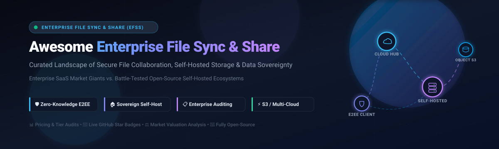

<p align="center">
  
</p>

<h1 align="center">Awesome Enterprise File Sync &amp; Share (EFSS)</h1>

<p align="center">
  <strong>Curated directory of Enterprise SaaS platforms and battle-tested Open-Source GitHub projects for secure file collaboration, self-hosted cloud storage, and digital data sovereignty.</strong>
</p>

<p align="center">
  <a href="https://github.com/ishandutta2007/Awesome-Enterprise-File-Sync-Share-EFSS/stargazers"></a>
  <a href="https://github.com/sindresorhus/awesome"></a>
  <a href="https://github.com/ishandutta2007/Awesome-Enterprise-File-Sync-Share-EFSS/blob/main/LICENSE"></a>
  <a href="https://github.com/ishandutta2007/Awesome-Enterprise-File-Sync-Share-EFSS/pulls"></a>
</p>

---

## 📑 Table of Contents

- [🌐 Sector Overview & Market Dynamics](#-sector-overview--market-dynamics)
- [🏢 SaaS & Hosted EFSS Platforms](#-saas--hosted-efss-platforms)
  - [📊 SaaS Comparison & Pricing Matrix](#-saas-comparison--pricing-matrix)
  - [🔍 Deep-Dive: Enterprise SaaS Solutions](#-deep-dive-enterprise-saas-solutions)
- [🔓 Open-Source GitHub Projects](#-open-source-github-projects)
  - [⭐ Open-Source Ecosystem (Ranked by Stars)](#-open-source-ecosystem-ranked-by-stars)
  - [🛠️ Specialized Sync Engines & Protocols](#️-specialized-sync-engines--protocols)
- [🧭 EFSS Architecture & Evaluation Guide](#-efss-architecture--evaluation-guide)
- [🤝 How to Contribute](#-how-to-contribute)
- [⚖️ Disclaimer & Compliance Notice](#️-disclaimer--compliance-notice)

---

## 🌐 Sector Overview & Market Dynamics

The global **Enterprise File Sync and Share (EFSS)** market is estimated at **$12.0 billion to $15.7 billion in 2025–2026** and is projected to expand to **$20.3 billion to $38.5 billion by 2030** (surpassing **$96 billion by 2035**), compounding at an impressive **11.2% to 22.3% CAGR**. Growth is heavily accelerated by hybrid and distributed workplace operations, stringent digital data sovereignty mandates (e.g., EU GDPR, NIS2, HIPAA, FINRA), Zero Trust architectural integrations, and the rapid deployment of enterprise AI copilot assistants over internal unstructured content.

In terms of industry concentration, the EFSS sector exhibits **moderate concentration at the top paired with a highly fragmented, resilient long tail** (a distinct barbell dynamic rather than a strict winner-take-all monopoly):
- **Mega-Cap Hyper-Scalers (High Concentration):** Microsoft (OneDrive / Microsoft 365) and Alphabet (Google Workspace Drive) command the largest enterprise volume by bundling baseline file synchronization directly into corporate office productivity suites.
- **Specialized Enterprise Pure-Plays (Concentrated Mid-Market):** Dedicated content governance platforms like Box, Dropbox Business, ShareFile, and Egnyte maintain entrenched market positions by delivering advanced enterprise content management (ECM), custom API integrations, and hybrid-cloud file governance.
- **Privacy & Sovereign Long-Tail (High Fragmentation):** Rising data residency scrutiny and vulnerability to US CLOUD Act sub-poenas drive organizations toward **zero-knowledge encrypted SaaS** (Tresorit, Sync.com) and **self-hosted open-source software** (Nextcloud, Seafile, ownCloud). This segment allows enterprises and public sector agencies to achieve total infrastructure independence and verifiable on-premises security.

---

## 🏢 SaaS & Hosted EFSS Platforms

Commercial SaaS solutions provide turn-key global availability, managed high availability, single sign-on (SSO), and extensive certified compliance frameworks (SOC 2 Type II, ISO 27001, HIPAA, FedRAMP).

### 📊 SaaS Comparison & Pricing Matrix

The table below lists the top commercial EFSS providers, **sorted in descending order by parent company valuation / market capitalization**.

| 🏷️ Provider / Service | 💼 Company Size (Valuation / Revenue) | 💵 Starting Tier Pricing | 🎁 Free Tier / Free Trial Limits | 🛡️ Key Enterprise Focus & Differentiators |
| :--- | :--- | :--- | :--- | :--- |
| **[Microsoft OneDrive for Business](https://www.microsoft.com/en-us/microsoft-365/onedrive/online-cloud-storage)** | **~$3.12 Trillion** Market Cap<br>*(~$245.1B Annual Rev)* | **$5.00** / user / month<br>*(OneDrive Plan 1, annual billing, 1 TB/user)* | **5 GB free forever** (personal Microsoft account); **30-day free trial** for M365 Business (up to 25 seats, 1 TB/user) | Deep Microsoft 365 / Windows OS integration, Azure AD/Entra ID conditional access, Office co-authoring, and DLP policies. |
| **[Google Workspace Drive](https://workspace.google.com/products/drive/)** | **~$2.15 Trillion** Market Cap<br>*(~$350.0B Annual Rev)* | **$6.00** / user / month<br>*(Business Starter, annual commitment, 30 GB/user)* | **15 GB free forever** (shared across Gmail/Drive/Photos); **14-day free trial** for Workspace (up to 10 users, 30 GB/user) | Native browser-first collaboration (Docs, Sheets, Slides), Gemini AI search & summarization, and team Shared Drives. |
| **[OpenText Hightail](https://www.hightail.com/)** | **~$8.55 Billion** Market Cap<br>*(~$5.80B Annual Rev)* | **$12.00** / month<br>*(Pro tier, annual billing, unlimited storage, 1 user)* | **2 GB free forever** (Lite: 100 MB max upload, 7-day link expiry); **14-day free trial** for Teams & Business plans | Tailored for creative media reviews, visual feedback markups, 500 GB file transfers, and agency client delivery portals. |
| **[Dropbox Business](https://www.dropbox.com/business)** | **~$8.20 Billion** Market Cap<br>*(~$2.54B Annual Rev)* | **$15.00** / user / month<br>*(Standard, annual billing, min. 3 users, 5 TB pooled)* | **2 GB free forever** (Dropbox Basic, 3-device sync limit); **30-day free trial** for Business Standard & Advanced (up to 3 users) | Ultra-fast block-level differential sync, Dropbox Replay media collaboration, DocSend document analytics, and team spaces. |
| **[Box](https://www.box.com/)** | **~$4.85 Billion** Market Cap<br>*(~$1.08B Annual Rev)* | **$5.00** / user / month<br>*(Business Starter, annual, min. 3 / max 10 users, 100 GB)* | **10 GB free forever** (Box Individual: 250 MB max file upload size); **14-day free trial** for Box Business (up to 10 users) | Comprehensive Enterprise Content Management (ECM), Box Sign (native e-signatures), Box Shield Zero Trust security, and FINRA compliance. |
| **[Citrix ShareFile](https://www.sharefile.com/)** | **~$2.60 Billion** Market Cap *(Parent)*<br>*(Acquired for $875M by Progress Software)* | **$16.50** / user / month<br>*(Advanced plan, annual billing, min. 3 users)* | **30-day free trial** (no credit card required, up to 5 users, includes client portal, e-signatures, and unlimited storage) | High-compliance client portals, automated document workflows, IRS/FINRA audit logging, and integrated digital e-signatures. |
| **[Egnyte](https://www.egnyte.com/)** | **~$1.60 Billion** Valuation<br>*(~$210M+ Annual ARR)* | **$22.00** / user / month<br>*(Business plan, annual billing, 1-100 users, 100 GB/user)* | **15-day free trial** (no credit card required, up to 10 users, 100 GB pooled storage, full ransomware protection access) | Hybrid-cloud architecture (local on-prem NAS/SAN cache + cloud), AEC/Life Sciences industry compliance, and real-time ransomware defense. |
| **[Tresorit](https://tresorit.com/)** | **~$120 Million** Valuation<br>*(Acquired by Swiss Post; Parent Rev ~$9.2B)* | **$14.50** / user / month<br>*(Business Standard, annual billing, min. 3 users, 1 TB/user)* | **3 GB free forever** (Tresorit Basic: zero-knowledge E2EE, max 2 devices); **14-day free trial** for Business plans (up to 10 users) | Swiss-grade zero-knowledge end-to-end encryption (E2EE), client-side cryptographic key generation, and strict data sovereignty. |
| **[Sync.com](https://www.sync.com/)** | **~$100 Million** Valuation *(Est.)*<br>*(~$28M+ Annual ARR)* | **$6.00** / user / month<br>*(Teams Standard, annual billing, min. 3 users, 1 TB/user)* | **5 GB free forever** (Sync Starter: zero-knowledge E2EE, up to 5 devices, 3 shared links); **30-day money-back guarantee** on paid plans | Canadian PIPEDA & HIPAA compliant zero-knowledge cloud storage, encrypted password-protected link sharing, and ransomware recovery. |
| **[pCloud](https://www.pcloud.com/)** | **~$75 Million** Valuation *(Est.)*<br>*(~$22M+ Annual ARR)* | **$7.99** / user / month<br>*(pCloud Business, annual billing, min. 3 users, 1 TB/user)* | **10 GB free forever** (starts at 2 GB, unlock up to 10 GB via tasks; 500 MB link traffic limit); **30-day free trial** for Business | Swiss jurisdiction, client-side encryption (pCloud Crypto), virtual drive disk mounting (pCloud Drive), and optional lifetime purchase licenses. |

---

### 🔍 Deep-Dive: Enterprise SaaS Solutions

- 🔷 **[Microsoft OneDrive for Business](https://www.microsoft.com/en-us/microsoft-365/onedrive/online-cloud-storage)**  
  Microsoft's enterprise cloud storage integrated seamlessly with Microsoft 365, Teams, and SharePoint. Starting at **$5.00/user/month** (annual Plan 1) or **$6.00/user/month** (Business Basic). Provides 1 TB to 5 TB+ per seat, delta-sync engine for Office files, automated versioning, and enterprise data loss prevention (DLP).
  - *Free Tier Details:* **5 GB free forever** on personal Microsoft accounts; **30-day free trial** for Business plans (up to 25 seats).

- 🔶 **[Google Workspace Drive](https://workspace.google.com/products/drive/)**  
  Google's cloud storage backbone powering Google Docs, Sheets, and Slides. Starting at **$6.00/user/month** (Business Starter). Best-in-class multi-user real-time document co-authoring, Gemini-powered context search, and granular access levels on Shared Drives.
  - *Free Tier Details:* **15 GB free forever** across Drive/Gmail/Photos; **14-day free trial** for Google Workspace (up to 10 users).

- 🎨 **[OpenText Hightail](https://www.hightail.com/)**  
  Enterprise file sharing platform purpose-built for media, advertising, and creative production workflows. Starting at **$12.00/month** (Pro plan) with unlimited storage. Supports rapid sending of massive creative files (up to 500 GB in Business), frame-by-frame video commenting, and visual approval tracking.
  - *Free Tier Details:* **2 GB free forever** (Lite tier, 100 MB max upload); **14-day free trial** on professional and business tiers.

- 📦 **[Dropbox Business](https://www.dropbox.com/business)**  
  Pioneer in synchronized cloud storage. Starting at **$15.00/user/month** (Standard plan, min. 3 seats) or **$16.58/month** (individual Essentials). Known for industry-leading block-level sync speed, seamless desktop virtual drive integration, Dropbox Paper, and Dropbox Replay video reviews.
  - *Free Tier Details:* **2 GB free forever** (Dropbox Basic, 3 synced devices); **30-day free trial** on Business Standard and Advanced tiers.

- 🗄️ **[Box](https://www.box.com/)**  
  Cloud Content Management (CCM) powerhouse for large enterprises in heavily regulated sectors. Starting at **$5.00/user/month** (Business Starter, min. 3 users) or **$15.00/user/month** (Business, unlimited storage). Features automated document retention policies, native Box Sign e-signatures, Box Shield ML-based anomaly detection, and integrations with Salesforce, ServiceNow, and Slack.
  - *Free Tier Details:* **10 GB free forever** (Box Individual Free, 250 MB upload cap); **14-day free trial** on Business tiers (up to 10 users).

- 📑 **[Citrix ShareFile](https://www.sharefile.com/)**  
  Secure document exchange and client portal solution (now under Progress Software). Starting at **$16.50/user/month** (Advanced plan, min. 3 users). Trusted by legal, accounting, financial, and healthcare practices for branded client upload portals, automated approval flows, and IRS/HIPAA compliant workflows.
  - *Free Tier Details:* **30-day free trial** with full enterprise capabilities, unlimited storage, and built-in e-signatures (no credit card required).

- 🏛️ **[Egnyte](https://www.egnyte.com/)**  
  Hybrid content governance platform that bridges local storage (NAS/SAN devices) with multi-cloud backends. Starting at **$22.00/user/month** (Business plan, billed annually). Outstanding for AEC (architecture, engineering, construction) handling massive CAD/BIM files locally with cloud sync and behavioral ransomware detection.
  - *Free Tier Details:* **15-day free trial** for up to 10 users with 100 GB storage (no credit card required).

- 🔐 **[Tresorit](https://tresorit.com/)**  
  Swiss-based, zero-knowledge encrypted cloud storage provider owned by Swiss Post. Starting at **$14.50/user/month** (Business Standard, min. 3 users) or **$24.00/month** (Solo). Files are encrypted client-side using AES-256 before upload; neither Tresorit nor server hosts possess decryption keys.
  - *Free Tier Details:* **3 GB free forever** (Tresorit Basic, 500 MB upload limit, 2 devices); **14-day free trial** on Business tiers.

- 🍁 **[Sync.com](https://www.sync.com/)**  
  Canadian end-to-end encrypted EFSS platform. Starting at **$6.00/user/month** (Teams Standard, min. 3 users) or **$8.00/month** (Solo Basic). Guarantees zero-knowledge privacy, compliance with Canadian PIPEDA, US HIPAA, and EU GDPR, along with ransomware rollback protection.
  - *Free Tier Details:* **5 GB free forever** (Sync Starter, up to 5 devices, 3 password-protected links); **30-day money-back guarantee** on paid subscriptions.

- ☁️ **[pCloud](https://www.pcloud.com/)**  
  Swiss privacy-centered personal and team cloud storage. Starting at **$7.99/user/month** (pCloud Business, min. 3 seats) or **$4.17/month** ($49.99/yr Premium 500 GB). Offers optional client-side pCloud Crypto, virtual drive disk streaming, built-in media players, and lifetime purchase options.
  - *Free Tier Details:* **10 GB free forever** (2 GB base, expandable to 10 GB via setup bonuses); **30-day free trial** for Business accounts.

---

## 🔓 Open-Source GitHub Projects

Self-hosted and open-source EFSS systems empower enterprises to take complete ownership of their data infrastructure, eliminate vendor lock-in, satisfy stringent data residency laws, and customize storage backends (Local NVMe, Ceph, MinIO, AWS S3).

### ⭐ Open-Source Ecosystem (Ranked by Stars)

The following repositories are **sorted strictly in descending order by GitHub star count**. Each project includes a live star badge linking to its GitHub stargazers page.

---

#### 1. [Syncthing](https://github.com/syncthing/syncthing) [](https://github.com/syncthing/syncthing/stargazers)
- **License:** MPL-2.0 | **Language:** Go
- **Summary:** Continuous, peer-to-peer decentralized file synchronization protocol and daemon. Synchronizes files directly between devices over local LAN or across the internet via encrypted relay connections—with **no centralized server holding your data**.
- **Key Features:** TLS cryptographic authentication, automatic NAT traversal, UPnP, low resource footprint, cross-platform (Linux, Windows, macOS, Android, BSD).
- **Enterprise Fit:** Ideal for synchronizing engineering workstations, offsite backup sync, and air-gapped or edge node environments where centralized SaaS is prohibited.

---

#### 2. [Rclone](https://github.com/rclone/rclone) [](https://github.com/rclone/rclone/stargazers)
- **License:** MIT | **Language:** Go
- **Summary:** Known as "The Swiss Army knife of cloud storage". Rclone is a command-line program and virtual filesystem engine to sync, upload, download, and mount files across over 70 cloud object stores and EFSS protocols.
- **Key Features:** Supports S3, Google Cloud Storage, Azure Blob, OneDrive, Dropbox, SFTP, WebDAV, and FTP; includes client-side cryptographic hashing, chunked transfers, bandwidth throttling, and `rclone mount` virtual drive FUSE support.
- **Enterprise Fit:** Essential utility for enterprise storage migration, multi-cloud automated backup pipelines, and hybrid-cloud sync bridges.

---

#### 3. [Nextcloud Server](https://github.com/nextcloud/server) [](https://github.com/nextcloud/server/stargazers)
- **License:** AGPL-3.0 | **Language:** PHP / JavaScript
- **Summary:** The most comprehensive and widely deployed open-source enterprise collaboration suite in the world. Positioned as the sovereign European open-source counterweight to Microsoft 365 and Google Workspace.
- **Key Features:** Nextcloud Files (granular sync & share), Nextcloud Office (Collabora / OnlyOffice live document editing), Nextcloud Talk (secure video calls & chat), Nextcloud Groupware (calendar & mail), native desktop/mobile clients, SAML 2.0 / LDAP / OIDC SSO, and HIPAA/GDPR audit logging.
- **Enterprise Fit:** Best for public sector agencies, educational institutions, and enterprises requiring an all-in-one private cloud platform.

---

#### 4. [File Browser](https://github.com/filebrowser/filebrowser) [](https://github.com/filebrowser/filebrowser/stargazers)
- **License:** Apache-2.0 | **Language:** Go / Vue.js
- **Summary:** Lightweight, blazingly fast, single-binary file management interface within a specified directory. Provides a clean web application interface to navigate, edit, upload, and share files.
- **Key Features:** Multi-user management with custom permission flags, public link sharing with expiration dates and passwords, integrated code/text editor, media player, and Docker ready.
- **Enterprise Fit:** Perfect for teams wanting a minimal, frictionless file access layer over existing local or NAS directory structures without database bloat.

---

#### 5. [Cloudreve](https://github.com/cloudreve/cloudreve) [](https://github.com/cloudreve/cloudreve/stargazers)
- **License:** GPL-3.0 | **Language:** Go / React
- **Summary:** Modern self-hosted file management and sharing system with unified multi-storage provider abstraction.
- **Key Features:** Bridges local disks, remote WebDAV servers, AWS S3, Aliyun OSS, Tencent COS, and OneDrive into a single unified web console; supports chunked resumable uploads, WebDAV client access, and custom user quotas.
- **Enterprise Fit:** Ideal for companies that want to build a white-labeled cloud drive UI backed by low-cost public object storage.

---

#### 6. [Seafile](https://github.com/haiwen/seafile) [](https://github.com/haiwen/seafile/stargazers)
- **License:** AGPL-3.0 (Server Core) / Apache-2.0 | **Language:** C / Python / Go
- **Summary:** High-performance, enterprise-grade file synchronization platform built on a Git-like content-addressable library model. Renowned for raw sync speed, reliability, and block-level deduplication.
- **Key Features:** Client-side encrypted libraries, SeaDrive virtual disk driver for on-demand caching, SeaSearch full-text document indexing, Kanban and gallery database views, and AI-assisted metadata extraction.
- **Enterprise Fit:** Best-in-class choice for organizations that manage millions of files and require high sync throughput combined with structured library-level access control.

---

#### 7. [Dufs](https://github.com/sigoden/dufs) [](https://github.com/sigoden/dufs/stargazers)
- **License:** Apache-2.0 / MIT | **Language:** Rust
- **Summary:** Ultra-fast, lightweight, all-in-one file server written in Rust, supporting static file serving, authenticated uploads, search, and full WebDAV synchronization.
- **Key Features:** Zero runtime dependencies, single binary distribution, path-based access control rules, full-text searching, range requests for media streaming, and negligible CPU/RAM footprint.
- **Enterprise Fit:** Excellent for microservice deployments, edge file sharing, automated CI/CD artifact storage, and rapid internal team file exchanges.

---

#### 8. [ownCloud Core](https://github.com/owncloud/core) [](https://github.com/owncloud/core/stargazers)
- **License:** AGPL-3.0 | **Language:** PHP / JavaScript
- **Summary:** The original pioneer in self-hosted EFSS solutions. Provides a proven, mature file synchronization engine with cross-platform clients and a vast repository of enterprise extensions.
- **Key Features:** WebDAV API, desktop and mobile clients, federated cloud sharing, LDAP/Active Directory integration, and Collabora/OnlyOffice online editing.
- **Enterprise Fit:** Suited for established organizations with existing PHP/LAMP hosting infrastructure looking for a battle-tested file server.

---

#### 9. [OnionShare](https://github.com/onionshare/onionshare) [](https://github.com/onionshare/onionshare/stargazers)
- **License:** GPL-3.0 | **Language:** Python
- **Summary:** Next-generation security tool that enables secure and anonymous file sharing, chat hosting, and web publishing directly over the Tor network.
- **Key Features:** End-to-end encrypted ephemeral onion services, zero third-party metadata footprint, password protection, and automated self-closing download links.
- **Enterprise Fit:** Critical tool for whistleblowers, investigative journalists, cybersecurity incident responders, and sensitive legal evidence collection.

---

#### 10. [OpenCloud](https://github.com/opencloud-eu/opencloud) [](https://github.com/opencloud-eu/opencloud/stargazers)
- **License:** Apache-2.0 | **Language:** Go
- **Summary:** Cloud-native file collaboration and synchronization server engineered specifically to meet European data sovereignty standards and high-concurrency cloud environments.
- **Key Features:** Written in Go with minimal container overhead, modular pluggable storage engines, Docker and Kubernetes-native configurations, and WebDAV support.
- **Enterprise Fit:** Modern alternative for teams transitioning away from monolithic PHP stacks toward lightweight Go-based container deployments.

---

#### 11. [Pydio Cells](https://github.com/pydio/cells) [](https://github.com/pydio/cells/stargazers)
- **License:** AGPL-3.0 | **Language:** Go
- **Summary:** Enterprise Document Management and File Sharing platform built from the ground up as a cloud-native microservices architecture in Go.
- **Key Features:** "Cells" workspace paradigm with fine-grained role-based access control (RBAC), OpenID Connect (OIDC) identity provider integration, advanced metadata tagging, detailed audit trails, and automated security policies.
- **Enterprise Fit:** Designed specifically for enterprise security architects who require compliance, microservices modularity, and integration with S3 storage layers.

---

#### 12. [ownCloud Infinite Scale (oCIS)](https://github.com/owncloud/ocis) [](https://github.com/owncloud/ocis/stargazers)
- **License:** Apache-2.0 | **Language:** Go
- **Summary:** Complete next-generation rewrite of ownCloud. Built as a cloud-native, microservices-driven platform in Go, discarding the legacy PHP/database architecture in favor of extreme sync scalability.
- **Key Features:** "Spaces" concept for project-centric data governance, metadata stored alongside data (no traditional SQL bottleneck), decoupled microservices, and instant Collabora/OnlyOffice document editing.
- **Enterprise Fit:** Tailor-made for petabyte-scale research facilities, university consortiums (e.g., CERN, SURF), and hyperscale enterprise deployments.

---

#### 13. [Sync-in Server](https://github.com/Sync-in/server) [](https://github.com/Sync-in/server/stargazers)
- **License:** AGPL-3.0 | **Language:** Go / Vue.js
- **Summary:** Actively maintained open-source file storage and synchronization server supported by the Docker-Sponsored Open Source Program.
- **Key Features:** Built-in OIDC / LDAP enterprise authentication, MFA enforcement, "Spaces" collaborative shared folders, Collabora and OnlyOffice online office integration, full-text search, and WebDAV protocol.
- **Enterprise Fit:** Great lightweight alternative for IT departments that need turnkey OIDC/LDAP single sign-on without complex enterprise licensing.

---

#### 14. [Cozy Stack](https://github.com/linagora/cozy-stack) [](https://github.com/linagora/cozy-stack/stargazers)
- **License:** AGPL-3.0 | **Language:** Go
- **Summary:** Core server for Cozy Cloud, providing a personal and team digital cloud platform. Backed by CouchDB for resilient metadata and document indexing.
- **Key Features:** Client-side file syncing, virtual file mount, data connectors for automated invoice and document fetching, and strong privacy controls.
- **Enterprise Fit:** Best for organizations and consumer-facing applications prioritizing individual digital sovereignty and automated personal document aggregation.

---

#### 15. [bewCloud](https://github.com/bewcloud/bewcloud) [](https://github.com/bewcloud/bewcloud/stargazers)
- **License:** AGPL-3.0 | **Language:** TypeScript / Node.js
- **Summary:** Modern, minimalist self-hosted alternative to Nextcloud and ownCloud, consolidating file sync, markdown notes, and photo galleries into one lightweight package.
- **Key Features:** Clean web UI, Docker-first distribution, mobile-friendly design, low memory overhead, and straightforward file sharing links.
- **Enterprise Fit:** Ideal for small teams, dev shops, and branch offices seeking an unbloated alternative to large enterprise cloud suites.

---

#### 16. [Samba](https://github.com/samba-team/samba) [](https://github.com/samba-team/samba/stargazers)
- **License:** GPL-3.0 | **Language:** C
- **Summary:** The gold standard Unix/Linux software suite that provides seamless SMB/CIFS networking, file, and print services for Windows, macOS, and Linux clients.
- **Key Features:** Active Directory Domain Controller (AD DC) emulation, POSIX ACL mapping, Winbind integration, high-throughput network file sharing, and Kerberos authentication.
- **Enterprise Fit:** Mission-critical infrastructure component for hosting high-speed local network shares on enterprise Linux servers.

---

### 🛠️ Specialized Sync Engines & Protocols

- 🌐 **[Git Annex](https://git-annex.branchable.com/)**  
  Content-addressed distributed file synchronization engine built on top of Git. Keeps file contents out of the Git tree while retaining Git's versioning and branching capabilities. Ideal for scientific research teams, video post-production pipelines, and large dataset distribution across cold storage remotes.

- 🗄️ **Storage Backend Integrations**:
  - **AWS S3 / MinIO / Ceph:** Deploy alongside Seafile, Cloudreve, Nextcloud, or Pydio Cells for scalable, distributed object storage.
  - **Collabora Online / ONLYOFFICE Docs:** Plug into Nextcloud, ownCloud oCIS, or Sync-in to unlock real-time browser-based doc, sheet, and presentation editing.

---

## 🧭 EFSS Architecture & Evaluation Guide

When evaluating whether to adopt a commercial SaaS provider or deploy a self-hosted open-source platform, consider the following trade-offs:

```
+--------------------------------------------------------------------------------------------------+
|                                    EFSS EVALUATION MATRIX                                        |
+--------------------------+-------------------------------------+---------------------------------+
| Architectural Attribute  | Commercial Enterprise SaaS          | Self-Hosted Open-Source         |
+--------------------------+-------------------------------------+---------------------------------+
| Data Sovereignty         | Provider-hosted (US CLOUD Act risk) | 100% Sovereign on-premises/colo |
| Zero-Knowledge E2EE      | Available on niche tools (Tresorit) | Native in Seafile / Syncthing   |
| Maintenance Burden       | Zero (Fully managed infrastructure) | High (OS/DB patching & backups) |
| User Directory (SSO/IAM) | Microsoft Entra ID, Okta, Ping      | OIDC, SAML 2.0, LDAP, FreeIPA   |
| Custom Storage Backends  | Locked to vendor cloud tiers        | POSIX, NVMe, Ceph, MinIO, S3    |
| Cost Scaling             | Per-user monthly recurring fee      | Hardware / Cloud VM + Storage   |
+--------------------------+-------------------------------------+---------------------------------+
```

---

## 🤝 How to Contribute

Contributions are warmly encouraged! To propose a new SaaS solution or open-source repository:

1. **Fork** this repository.
2. **Create a branch:** `git checkout -b feature/add-new-efss-tool`.
3. **Add entry in `README.md`:**
   - For **SaaS**: Include product name, official link, starting price, free tier/trial limits, company size (valuation/revenue), and core enterprise highlights.
   - For **Open-Source**: Include repository name, link, `style=social&color=white` GitHub star badge linking to the stargazers page, license, and technical summary. Keep the list sorted by star count.
4. **Submit a Pull Request** with a concise summary of changes.

---

## ⚖️ Disclaimer & Compliance Notice

- This curated list is maintained for educational and informational purposes by the open-source community. Inclusion does not imply official endorsement or sponsorship.
- Enterprise security and compliance certifications (e.g., SOC 2, ISO 27001, HIPAA, GDPR, FedRAMP) are subject to periodic audit cycles. Always confirm current compliance statuses directly with vendors before storing sensitive or regulated data.
- Self-hosted deployments require continuous security hardening, automated backup verification, and SSL/TLS certificate rotation.

---

<p align="center">
  <sub>Built with ❤️ for IT architects, DevOps engineers, and privacy advocates worldwide.</sub>
</p>
